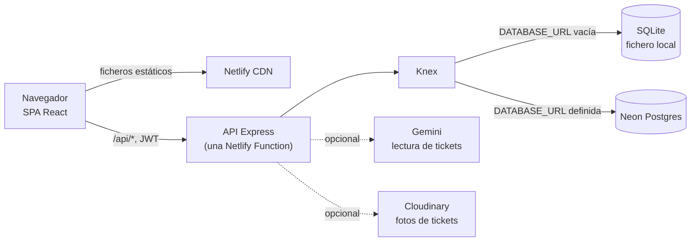

# Repartix

Divide gastos de grupo a partir de una foto del ticket.

🇬🇧 [Read this in English](README.md)

[](https://github.com/jmartintechit-blip/Repartix/actions/workflows/ci.yml)
[](LICENSE)
[](https://repartix-demo.netlify.app)


Repartix permite a un grupo anotar quién pagó cada gasto, marcar qué artículos consumió cada persona, y calcula quién debe a quién con el menor número posible de pagos. Una IA de visión puede leer la foto de un ticket y rellenar los artículos y precios; sin ella, todo funciona introduciendo los datos a mano.


**[Prueba la demo](https://repartix-demo.netlify.app)**. Regístrate con un nombre y un email ficticios: las cuentas no se verifican y la demo es pública, así que no uses datos reales. Puede reiniciarse en cualquier momento. También puedes ejecutarla en local con tres comandos (ver [Inicio rápido](#inicio-rápido)). La interfaz está en español.

> Repartix no es una app de pagos: nunca mueve dinero, solo te dice quién debe a quién. Es un proyecto de portfolio, no un servicio alojado. Ver [Limitaciones conocidas](#limitaciones-conocidas).

## Por qué existe

Repartir la cuenta de un viaje o una cena suele acabar en una hoja de cálculo improvisada o en un "ya te lo doy luego" que nunca llega. Repartix automatiza las dos partes tediosas: leer el ticket y calcular quién paga a quién. A las personas solo les queda marcar los artículos que fueron suyos.

## Qué hace

- Registro e inicio de sesión, con contraseñas cifradas y sesiones JWT.
- Página de cuenta: cambiar el nombre o la contraseña, o eliminar la cuenta. Al eliminarla se borran tu nombre y tu email; si aún tienes gastos, partes o liquidaciones en un grupo, la cuenta queda anonimizada («Usuario eliminado») para que los balances de los demás sigan siendo correctos. El token de una cuenta eliminada deja de funcionar al instante.
- Crear un grupo, o unirse a uno con un código de invitación de 6 caracteres.
- Gestionar un grupo: quien lo creó puede renombrarlo, cambiar el código de invitación, quitar a un miembro o eliminarlo; los miembros pueden salir. Quien tenga gastos, partes asignadas o liquidaciones en el grupo no se puede quitar, así que los balances siempre cuadran.
- Añadir un gasto con sus artículos. Opcionalmente, subir la foto del ticket y dejar que Gemini extraiga los artículos y el total, editables antes de guardar.
- Editar un gasto ya guardado (solo quien lo pagó): los artículos que se mantienen conservan quién los tomó.
- Cada miembro marca los artículos que consumió, o el gasto se reparte a partes iguales con un clic.
- Balance neto por persona, con impuestos y propina prorrateados entre los artículos.
- Simplificación de deudas: si A debe a B y B debe a C, A paga directamente a C.
- Historial de gastos con la foto del ticket enlazada.
- Marcar una liquidación como pagada. Solo pueden hacerlo las dos personas implicadas, y la app lo recuerda, así que un gasto posterior nunca pide un pago ya hecho.

| Login                                         | Tus grupos                                       |
| --------------------------------------------- | ------------------------------------------------ |
|  |  |
| **Detalle de grupo**                          | **Asignar quién consumió qué**                   |
|  |  |

Todos los nombres, importes y capturas son ficticios.

## Cómo se calcula el reparto

1. En cada gasto, quien pagó se anota el importe completo a favor, y ese importe (con impuestos y propina prorrateados entre los artículos) se divide entre las personas asignadas a cada artículo.
2. Todo se hace **en céntimos enteros**, con el método del resto mayor, así que lo cobrado y lo repartido siempre cuadran exactamente. Sin redondeos de `float`.
3. Con el balance neto de cada persona, un algoritmo greedy empareja en cada paso al mayor deudor con el mayor acreedor.
4. Las liquidaciones ya marcadas como pagadas se recuerdan.

**Ejemplo resuelto** (el mismo escenario que comprueba la suite de tests y el de las capturas). Ana paga una cena de 30,00: una pizza de 12,00 compartida por Ana y Bruno, y una pasta de 18,00 compartida por los tres. Bruno paga una cuenta de bar de 45,00 repartida a partes iguales entre los tres.

| Persona | Pagó  | Debe  | Balance neto |
| ------- | ----: | ----: | -----------: |
| Ana     | 30,00 | 27,00 |        +3,00 |
| Bruno   | 45,00 | 27,00 |       +18,00 |
| Carla   |  0,00 | 21,00 |       -21,00 |

Carla debe 21,00 en total, saldados en dos pagos: 18,00 a Bruno y 3,00 a Ana.

## Arquitectura



Decisiones de diseño que importan:

- **El dinero son céntimos enteros en todas partes.** El reparto y la simplificación de deudas nunca usan floats.
- **La misma app Express se ejecuta en local y como función serverless.** `backend/src/app.js` la construye; `server.js` escucha en local, y `backend/netlify/functions/api.mjs` la envuelve para Netlify.
- **La misma app Express se ejecuta en local y como función serverless.** `backend/src/app.js` la construye; `server.js` escucha en local, y `backend/netlify/functions/api.mjs` la envuelve para Netlify.
- **Una capa de datos para dos bases de datos.** Los servicios hablan con Knex, así que el mismo código funciona con SQLite en desarrollo y con Postgres cuando se define `DATABASE_URL`. Las migraciones se aplican al arrancar.
- **Capas.** Rutas, luego controladores (validan con Zod y responden), luego servicios (lógica de negocio y consultas).
- **La parte de IA es opcional.** Sin claves de Gemini o Cloudinary, el botón de escanear muestra un aviso y el resto de la app no se ve afectado.
- **Control de acceso por pertenencia.** Un middleware comprueba que quien llama pertenece al grupo antes de cualquier ruta de grupo.

## Tecnologías

| Área         | Elección                                                      |
| ------------ | ------------------------------------------------------------- |
| Backend      | Node.js, Express 4                                            |
| Base de datos | Knex 3 sobre SQLite (better-sqlite3) o Postgres (`pg`); Neon en la demo |
| Auth         | JWT y bcrypt                                                  |
| Validación   | Zod                                                           |
| Frontend     | React 19, Vite, React Router, CSS Modules (sin librería de UI) |
| IA de visión | Google Gemini (`gemini-2.5-flash`, salida estructurada)       |
| Imágenes     | Cloudinary                                                    |
| Tests        | Vitest, pg-mem (motor en memoria compatible con Postgres)     |
| Calidad      | oxlint, GitHub Actions, Dependabot                            |
| Alojamiento  | Netlify (sitio estático y una Function), Neon plan gratuito   |
| Alojamiento  | Netlify (sitio estático y una Function), Neon plan gratuito   |

## Inicio rápido

Necesitas Node 22 o superior (CI y el build de la demo usan Node 24, ver [`.nvmrc`](.nvmrc)). No hace falta ninguna cuenta ni clave de API.

```bash
cd backend && npm ci && cp .env.example .env   # luego define JWT_SECRET en .env
npm run dev                                    # API en :3001, crea el fichero SQLite y las tablas
cd ../frontend && npm ci && cp .env.example .env && npm run dev   # app en :5173 (segunda terminal)
```

Genera un valor para `JWT_SECRET` con `node -e "console.log(require('crypto').randomBytes(48).toString('hex'))"`.

### Opcional: escaneo de tickets

Sin estas variables, el botón de escanear ticket muestra un aviso y los gastos se introducen a mano.

| Variable                                                               | Dónde conseguirla                                                    |
| ---------------------------------------------------------------------- | -------------------------------------------------------------------- |
| `GEMINI_API_KEY`                                                       | [Google AI Studio](https://aistudio.google.com/apikey)               |
| `CLOUDINARY_CLOUD_NAME`, `CLOUDINARY_API_KEY`, `CLOUDINARY_API_SECRET` | [Cloudinary](https://cloudinary.com/users/register/free), Dashboard  |

### Despliegue

La demo corre en Netlify con una base de datos Postgres en Neon, ambos en planes gratuitos. [`netlify.toml`](netlify.toml) construye el frontend como ficheros estáticos y enruta `/api/*` a la app Express, envuelta como una sola Netlify Function. Define estas variables de entorno en la interfaz de Netlify, nunca en git:

| Variable       | Para qué sirve                                                                              |
| -------------- | ------------------------------------------------------------------------------------------- |
| `DATABASE_URL` | Cadena de conexión agrupada (pooled) de Neon. Las migraciones se aplican en la primera petición |
| `JWT_SECRET`   | Valor aleatorio largo que firma las sesiones                                                |
| `FRONTEND_URL` | La URL del propio sitio, para restringir el CORS                                            |
| `VITE_API_URL` | `/api`, para que el frontend llame a la API en el mismo origen                              |

La demo se despliega a mano (subida y build en Netlify), no automáticamente desde CI.

## Calidad y seguridad

**Tests.** 14 tests de Vitest en 3 ficheros pasan en este commit (`cd backend && npm test`): 13 cubren la lógica de dinero y deudas contra SQLite en memoria, y 1 repite el mismo escenario de gastos contra pg-mem para comprobar que las consultas de Knex son válidas en el dialecto de Postgres.

**CI** ([`ci.yml`](.github/workflows/ci.yml)) se ejecuta en cada push y pull request: tests del backend, y después lint y build de producción del frontend. El lint muestra algunos avisos de hooks de React y ningún error.

**Medidas de seguridad que realmente están en el código:**

- Contraseñas cifradas con bcrypt (10 rondas). Los JWT caducan a los 7 días. El servidor se niega a arrancar sin `JWT_SECRET`.
- El registro y el login tienen límite de peticiones (20 cada 15 minutos por cliente).
- Cada endpoint valida su entrada con Zod, y las rutas de grupo comprueban la pertenencia.
- Las subidas de tickets están limitadas a 8 MB y a JPEG, PNG, HEIC y WEBP.
- Los secretos viven en variables de entorno. Los ficheros `.env` están en `.gitignore` y solo se versionan los `.env.example`.

**Comprobación en vivo.** El 2026-10-20 pasó una prueba manual contra la demo desplegada: registro, login, rechazo de contraseña incorrecta, creación de grupo y unión a él, un gasto dividido a partes iguales con los balances esperados, y las respuestas 401/404 para peticiones sin token y para quien no es miembro. No forma parte de CI.

**Comprobación en vivo.** El 2026-10-20 pasó una prueba manual contra la demo desplegada: registro, login, rechazo de contraseña incorrecta, creación de grupo y unión a él, un gasto dividido a partes iguales con los balances esperados, y las respuestas 401/404 para peticiones sin token y para quien no es miembro. No forma parte de CI.

Para reportar vulnerabilidades, ver [SECURITY.md](SECURITY.md). Las alertas de Dependabot, el escaneo de secretos y la protección en push están activados en el repositorio.

## Limitaciones conocidas

- **Demo pública con registro abierto.** Las cuentas no se verifican y los datos no son privados. La demo puede reiniciarse, y la primera petición tras un rato de inactividad puede ser lenta (el plan gratuito de Neon suspende el cómputo tras 5 minutos sin actividad).
- **El Postgres de CI es simulado.** El test automático de Postgres corre sobre pg-mem. La base de datos real de Neon solo se comprobó a mano.
- **Despliegues manuales.** La demo no se vuelve a desplegar sola cuando cambia `main`.
- **El escaneo de tickets no tiene tests automáticos.** Las llamadas a Gemini y Cloudinary no se han ejercitado contra los servicios reales en CI.
- **La cobertura de tests es estrecha.** No hay tests del frontend, ni de las rutas HTTP, la autenticación o el control de acceso.
- **Token en el navegador.** El JWT se guarda en `localStorage`, así que un fallo XSS lo expondría.
- **Pocas cabeceras de seguridad y límite de peticiones parcial.** El sitio estático envía algunas cabeceras (`netlify.toml`), la API no envía ninguna (no hay `helmet`), y solo las rutas de autenticación tienen límite de peticiones, con contadores en memoria por instancia de la función.
- **La comprobación de subidas confía en el tipo declarado.** Los ficheros se filtran por el tipo MIME que envía el cliente, no por su contenido.
- **Sin recuperación de contraseña ni verificación de email.**
- **Solo en español.** La interfaz está en español y los identificadores y comentarios del código también lo están en su mayoría. Los importes se muestran en euros.

## Hoja de ruta

Ideas, no promesas:

- Desplegar la demo automáticamente desde CI y reiniciar sus datos de forma periódica.
- Ejecutar los tests de Postgres contra un Postgres real en CI.
- Tests de rutas para la autenticación y el control de acceso a grupos.
- Cabeceras de seguridad y sesión con cookie en lugar de `localStorage`.
- Tests del frontend.
- Comprobar el contenido de las subidas, no solo el tipo declarado.
- Interfaz en inglés.

## Desarrollado con asistencia de IA

La mayor parte del código se escribió con Claude Code, trabajando en pasos pequeños con el autor, que ejecutó la app y los tests. Si lo revisas, júzgalo por los tests y por el código, no por quién lo tecleó.

## Estructura del proyecto

```text
backend/src/
  routes/        endpoints Express, agrupados por recurso
  controllers/   validan la entrada y dan forma a la respuesta
  services/      lógica de negocio y acceso a datos
  middleware/    auth, pertenencia a grupo, subida de imágenes
  validators/    esquemas Zod
  db/            conexión Knex (SQLite o Postgres) y migraciones
frontend/src/
  pages/         una pantalla por ruta
  components/    sistema de diseño (ui), layout y guardas de ruta
  api/           un módulo por recurso sobre un cliente fetch común
  context/       estado global de autenticación
docs/images/     capturas y la imagen de vista previa social
```

`backend/` y `frontend/` tienen cada uno su propio `package.json` y se ejecutan de forma independiente.

## Licencia

[MIT](LICENSE)
