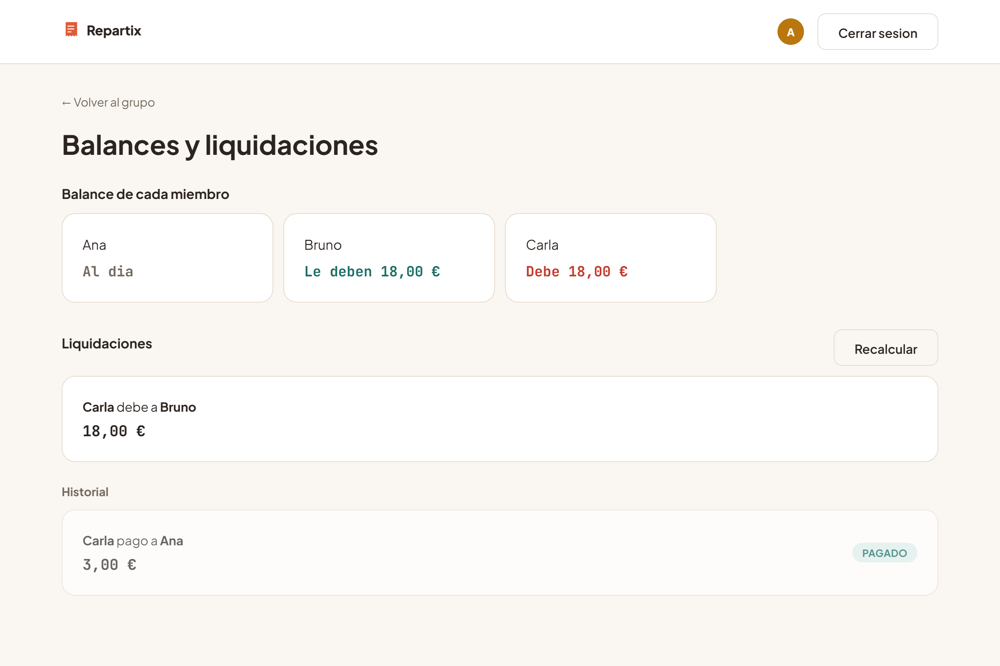
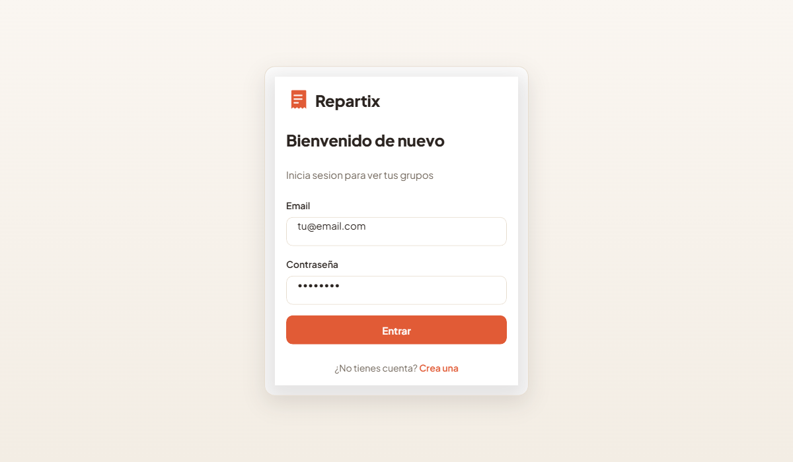
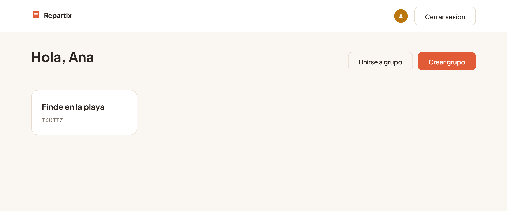
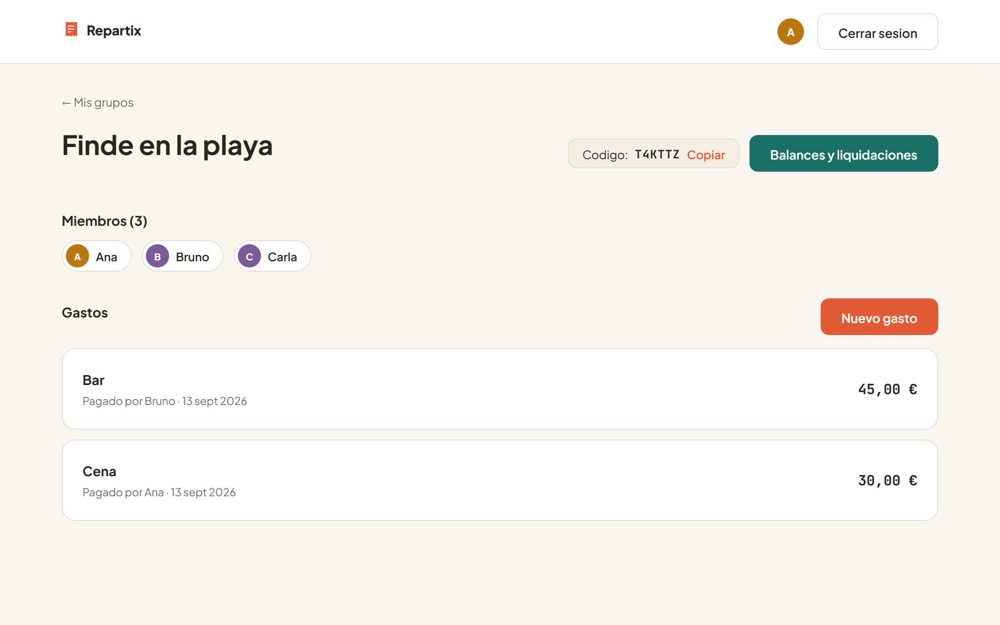
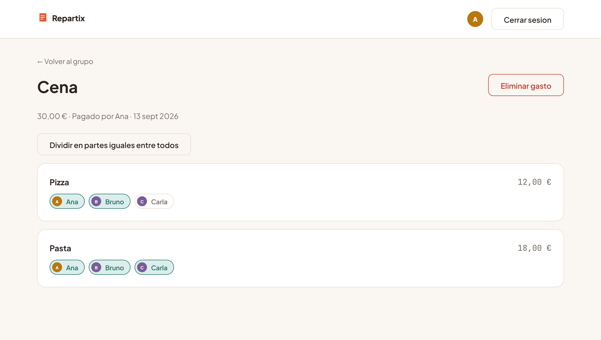
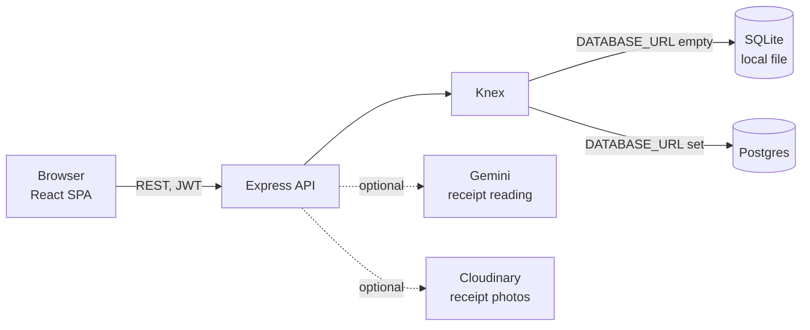

# Repartix

Split group expenses from a photo of the receipt.

🇪🇸 [Leer esto en español](README.es.md)

[](https://github.com/jmartintechit-blip/Repartix/actions/workflows/ci.yml)
[](LICENSE)


Repartix lets a group record who paid for what, mark which items each person had, and works out who owes whom with the fewest possible payments. A vision AI can read a receipt photo and pre-fill the items and prices; without it, everything works with manual entry.



**There is no live demo yet.** Run it locally in three commands (see [Quickstart](#quickstart)). The interface is in Spanish.

> Repartix is not a payment app: it never moves money, it only tells you who owes whom. It is a portfolio project, not a hosted service. See [Known limitations](#known-limitations).

## Why this exists

Splitting the bill after a trip or a dinner usually ends in an improvised spreadsheet, or an "I'll pay you back later" that never happens. Repartix automates the two tedious parts: reading the receipt, and working out who pays whom. What is left for people is ticking the items that were theirs.

## What it does

- Sign up and log in, with hashed passwords and JWT sessions.
- Create a group, or join one with a 6-character invite code.
- Add an expense with its line items. Optionally upload a receipt photo and let Gemini extract the items and total, editable before saving.
- Each member marks the items they had, or an expense is split equally in one click.
- Net balance per person, with tax and tip prorated across the items.
- Debt simplification: if A owes B and B owes C, A pays C directly.
- Expense history with the receipt photo linked.
- Mark a settlement as paid. Only the two people involved can do it, and the app remembers it, so a later expense never asks for a payment already made.

| Login                                         | Your groups                                      |
| --------------------------------------------- | ------------------------------------------------ |
|      |   |
| **Group detail**                              | **Assigning who had what**                       |
|  |  |

All names, amounts and screenshots are fictitious.

## How the split is calculated

1. For each expense, the payer is credited the full amount, and that amount (with tax and tip prorated across the items) is divided among the people assigned to each item.
2. All of it happens **in whole cents**, using the largest-remainder method, so what is collected and what is distributed always add up exactly. No `float` rounding.
3. Given every net balance, a greedy algorithm pairs the biggest debtor with the biggest creditor at each step.
4. Settlements already marked as paid are remembered.

**Worked example** (the same scenario the test suite checks, and the one in the screenshots). Ana pays a 30.00 dinner: a 12.00 pizza shared by Ana and Bruno, and an 18.00 pasta shared by all three. Bruno pays a 45.00 bar tab split equally among the three.

| Person | Paid  | Owes  | Net balance |
| ------ | ----: | ----: | ----------: |
| Ana    | 30.00 | 27.00 |       +3.00 |
| Bruno  | 45.00 | 27.00 |      +18.00 |
| Carla  |  0.00 | 21.00 |      -21.00 |

Carla owes 21.00 in total, settled as two payments: 18.00 to Bruno and 3.00 to Ana.

## Architecture



Design decisions that matter:

- **Money is integer cents everywhere.** The split and the debt simplification never touch floats.
- **One data layer for two databases.** Services talk to Knex, so the same code runs on SQLite in development and on Postgres when `DATABASE_URL` is set. Migrations run at startup.
- **Layers.** Routes, then controllers (validate with Zod and answer), then services (business logic and queries).
- **The AI part is optional.** Without Gemini or Cloudinary keys the scan button shows a notice and the rest of the app is unaffected.
- **Access control by membership.** A middleware checks that the caller belongs to the group before any group route.

## Tech stack

| Area       | Choice                                                    |
| ---------- | --------------------------------------------------------- |
| Backend    | Node.js, Express 4                                        |
| Database   | Knex 3 over SQLite (better-sqlite3) or Postgres (`pg`)    |
| Auth       | JWT and bcrypt                                            |
| Validation | Zod                                                       |
| Frontend   | React 19, Vite, React Router, CSS Modules (no UI library) |
| Vision AI  | Google Gemini (`gemini-2.5-flash`, structured output)     |
| Images     | Cloudinary                                                |
| Tests      | Vitest, pg-mem (in-memory Postgres-compatible engine)     |
| Quality    | oxlint, GitHub Actions, Dependabot                        |

## Quickstart

You need Node 22 or newer (see [`.nvmrc`](.nvmrc)). No account or API key is required.

```bash
cd backend && npm ci && cp .env.example .env   # then set JWT_SECRET in .env
npm run dev                                    # API on :3001, creates the SQLite file and tables
cd ../frontend && npm ci && cp .env.example .env && npm run dev   # app on :5173 (second terminal)
```

Generate a value for `JWT_SECRET` with `node -e "console.log(require('crypto').randomBytes(48).toString('hex'))"`.

### Optional: receipt scanning

Without these variables the "scan receipt" button shows a notice and expenses are entered by hand.

| Variable                                                              | Where to get it                                                       |
| --------------------------------------------------------------------- | --------------------------------------------------------------------- |
| `GEMINI_API_KEY`                                                      | [Google AI Studio](https://aistudio.google.com/apikey)                |
| `CLOUDINARY_CLOUD_NAME`, `CLOUDINARY_API_KEY`, `CLOUDINARY_API_SECRET` | [Cloudinary](https://cloudinary.com/users/register/free), Dashboard   |

### Deploying (documented, not exercised)

The target setup is the backend on Railway with its Postgres plugin and the frontend on Vercel. None of it has been deployed yet, so treat these steps as a plan.

1. Backend: connect the `backend/` folder, add the Postgres plugin (it provides `DATABASE_URL`), set `JWT_SECRET` and `FRONTEND_URL`, start with `npm start`.
2. Frontend: use `frontend/` as the root directory and set `VITE_API_URL` to the backend's public URL ending in `/api`.
3. `FRONTEND_URL` restricts CORS to that origin. Left empty (development), the API accepts any origin.

## Quality and security

**Tests.** 14 Vitest tests in 3 files pass on this commit (`cd backend && npm test`): 13 cover the money and debt logic against in-memory SQLite, and 1 replays the same expense scenario against pg-mem to check that the Knex queries are valid for the Postgres dialect.

**CI** ([`ci.yml`](.github/workflows/ci.yml)) runs on every push and pull request: backend tests, then frontend lint and production build. The lint step reports some React hooks warnings and no errors.

**Security measures actually in the code:**

- Passwords hashed with bcrypt (10 rounds). JWTs expire after 7 days. The server refuses to start without `JWT_SECRET`.
- Login and sign-up are rate limited (20 requests per 15 minutes per client).
- Every endpoint validates its input with Zod, and group routes check membership.
- Receipt uploads are capped at 8 MB and limited to JPEG, PNG, HEIC and WEBP.
- Secrets live in environment variables. `.env` files are git-ignored and only `.env.example` files are committed.

Vulnerability reports: see [SECURITY.md](SECURITY.md). Dependabot alerts, secret scanning and push protection are enabled on the repository.

## Known limitations

- **No live demo.** The Railway and Vercel setup is documented but has not been deployed.
- **Real Postgres is untested.** The Postgres path was only checked against pg-mem, because no Docker was available. Smoke-test sign-up and login right after a first deploy.
- **Receipt scanning is not covered by automated tests.** The Gemini and Cloudinary calls have not been exercised against the live services in CI.
- **Test coverage is narrow.** There are no frontend tests, and no tests for the HTTP routes, authentication or access control.
- **Browser-side token.** The JWT is kept in `localStorage`, so an XSS bug would expose it.
- **No security headers and limited rate limiting.** There is no `helmet`, and only the auth routes are rate limited.
- **Upload check trusts the declared type.** Uploads are filtered by the MIME type the client sends, not by file content.
- **No password recovery or email verification.**
- **Spanish only.** The interface is in Spanish and the code identifiers and comments are mostly Spanish too. Amounts are shown in euros.

## Roadmap

Ideas, not promises:

- Deploy a public demo and test against a real Postgres.
- Route-level tests for authentication and group access control.
- Security headers, and a cookie-based session instead of `localStorage`.
- Frontend tests.
- Check upload contents, not just the declared type.
- English interface.

## Built with AI assistance

Most of the code was written with Claude Code, working in small steps with the author, who ran the app and the tests. If you review it, judge it by the tests and the code, not by who typed it.

## Project structure

```text
backend/src/
  routes/        Express endpoints, grouped by resource
  controllers/   validate input and shape the response
  services/      business logic and data access
  middleware/    auth, group membership, image upload
  validators/    Zod schemas
  db/            Knex connection (SQLite or Postgres) and migrations
frontend/src/
  pages/         one screen per route
  components/    design system (ui), layout and route guards
  api/           one module per resource over a shared fetch client
  context/       global authentication state
docs/images/     screenshots and the social preview
```

`backend/` and `frontend/` each have their own `package.json` and run independently.

## License

[MIT](LICENSE)
